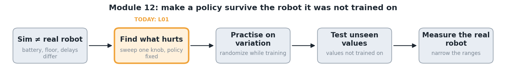

# Module 12 — Make a policy survive the robot it was not trained on

**Big question:** the real robot never matches the simulator. Which differences break a trained policy, and does practising on variation fix that?

Find what hurts by testing one fixed policy on changed robots; then train on a spread of robots and test on values it never saw.

## Lessons

| Lesson | Question you answer | What you change | What you see | Time | Status |
|---|---|---|---|---|---|
| [L01](https://github.com/JianZhongDev/LearnRLWithMicroDuck/tree/main/examples/12-domain-randomization-and-transfer/lessons/L01-where-it-breaks) | Where does a trained duck break? | battery voltage, floor friction, command delay | the same balancing policy under changed conditions; a robustness curve; a slider page | ~4 min (+10 min once to train the shared policy) | example |
| [L02](lessons/L02-practice-with-variation/LESSON.md) | Does practising with variation make it robust? | your practice ranges in `your_turn.py` | two policies side by side on the hardest robot; two robustness curves | ~15 min | example |

**You can do afterwards:** find the physical mismatches that matter for any learned controller, choose randomization ranges from measurements, and test robustness on held-out conditions.

From Learn RL with MicroDuck (MIT). Only L02 is copied here; the full module, with its labs, is in that repository's `examples/` folder.

