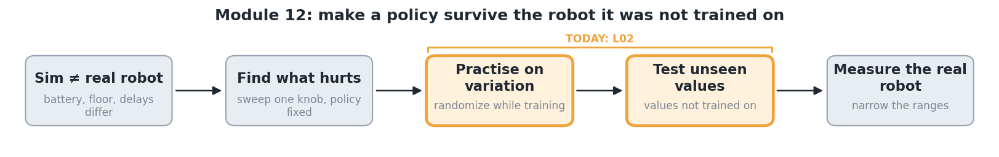

# 12.L02 Does practising with variation make it robust?



L01 found where the trained policy breaks. Now you choose what it practises on, and test whether that helps.

```python
# your_turn.py: your design
def practice_conditions():
    return {"delay_steps": (2, 12), "friction": (0.2, 1.2), "voltage": (4.5, 8.2)}
```

The lab trains two copies of the L01 policy for 4 more minutes each: one on the nominal robot only, one on your ranges. Then it tests both across command delays, where L01 showed the policy is most fragile.

🔧 **Run:** `lab 12/L02` (about 15 min). **Watch:** `compare.gif` at the longest delay, then `robustness.png`.

**Try:**
- Edit `your_turn.py`: make one range very wide, or randomize nothing.
- `lab 12/L02 test=friction` tests across floors instead.

**Takeaway:** *domain randomization* means training on a spread of robots, so the policy cannot rely on one exact robot. Too narrow and it breaks outside the range. Too wide and it may lose some performance on the normal robot. Test on values you did not train on.

<details><summary>why MicroDuck chose its ranges · caveats</summary>

- MicroDuck's ranges (6.5–8.2 V, friction 0.7–1.3, 15–30 ms delay) are meant to cover its real battery, floors and bus. Ranges should come from **measurements** of the real robot, widened by a margin.
- Randomization must not pile up across resets: each reset restores the default value, then applies a new random value (upstream `AGENTS.md`).
- Each copy trains 4 min with one seed. Differences of a few falls per minute can be noise. Rerun with `minutes=8` before concluding.

</details>

<sub>Sources: Tobin et al., IROS 2017; `microduck_rl` constants and `AGENTS.md` (Pollen Robotics, Apache-2.0). New term: **domain randomization**, see the takeaway. `lab` = `./lab.sh`, or `.\lab` on Windows.</sub>
