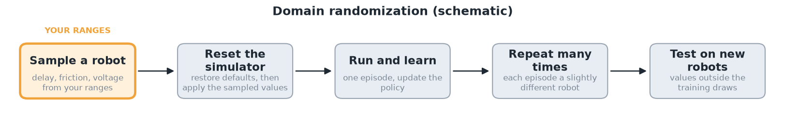

# 12.L02 Does practising with variation make it robust?

🎯 **Today: domain randomization.** A policy trained on one exact simulated robot learns to rely on that robot's battery, floor and timing, so it breaks on the real one. Domain randomization trains it on many slightly different robots instead, so no single version can be relied on.


L01 found where the trained policy breaks. Now you choose what it practises on, and test whether that helps.

## How it works



1. Before every training episode, draw one value for each parameter from the range you chose: command delay (simulation steps), floor friction, battery voltage.
2. Reset the simulator to its defaults, then apply those values. (Applying them on top of the previous episode's values would let randomness pile up.)
3. Run the episode and update the policy as usual.
4. After many episodes the policy has seen a spread of robots, so the behaviour that scores well is the one that works across the spread, not one that exploits a single robot's quirks.
5. Test on robots drawn from outside the training draws, which is what the real robot is.

```text
for episode in training:
    robot = sample(ranges)        # one random delay, friction, voltage
    env.reset(); env.apply(robot) # defaults first, then the sample
    update_policy(run(env))
evaluate(policy, test_robots)     # robots not used in training
```

Too narrow a range and the policy still breaks outside it. Too wide and it spends effort on robots that will never exist, and loses performance on the normal one.

## Data and setup

The lab uses the real MicroDuck simulator and the policy trained in L01 (no stand-ins). It trains two copies for 4 more minutes each: one on the nominal robot only, one on the ranges in your `your_turn.py`. It then tests both on the same set of robots with increasing command delay, where L01 showed the policy is most fragile.

```python
# your_turn.py: your design
def practice_conditions():
    return {"delay_steps": (2, 12), "friction": (0.2, 1.2), "voltage": (4.5, 8.2)}
```

## Reading guide

| What you will see | What it is | Good looks like |
|---|---|---|
| `robustness.png`, x axis | command delay in simulation steps; larger means a slower bus | – |
| `robustness.png`, y axis | falls per minute of walking; lower is better | a flat low line |
| grey line | the policy trained on the nominal robot only | rises sharply at long delay |
| coloured line | the policy trained on your ranges | stays low across the delays |
| `compare.gif` | the two policies side by side at the longest delay | the walking one stays upright |

## Predict

Which policy do you expect to fall more at the longest delay, and by roughly how much?

## Run

```bash
lab 12/L02      # about 15 min
```

**Try:**
- Edit `your_turn.py`: make one range very wide, or randomize nothing. Watch the left end of the lines (the normal robot).
- `lab 12/L02 test=friction` tests across floors instead.

## Takeaway

*Domain randomization* means training on a spread of robots, so the policy cannot rely on one exact robot. The spread should come from measurements of the real robot, widened by a margin, and testing must use values the policy did not train on. The same idea appears in sim-to-real vision (random textures and lighting) and in load-testing with randomized inputs.

<details><summary>why MicroDuck chose its ranges · caveats</summary>

- MicroDuck's ranges (6.5–8.2 V, friction 0.7–1.3, 15–30 ms delay) are meant to cover its real battery, floors and bus. Ranges should come from **measurements** of the real robot, widened by a margin.
- Randomization must not pile up across resets: each reset restores the default value, then applies a new random value (upstream `AGENTS.md`).
- Each copy trains 4 min with one seed. Differences of a few falls per minute can be noise. Rerun with `minutes=8` before concluding.

</details>

<sub>Sources: Tobin et al., IROS 2017; `microduck_rl` constants and `AGENTS.md` (Pollen Robotics, Apache-2.0). Data: the MicroDuck simulator itself. New term: **domain randomization**. `lab` = `./lab.sh`, or `.\lab` on Windows. Questions at any point are welcome: ask, or reply `explain again`.</sub>
