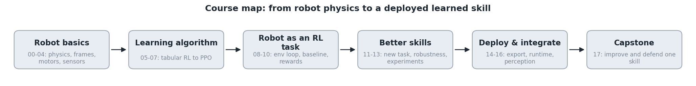

# Worked example: robotics and RL with MicroDuck

This method was distilled from building and trial-teaching [Learn RL with MicroDuck](https://github.com/JianZhongDev/LearnRLWithMicroDuck), a course that uses Pollen Robotics' open-source [MicroDuck](https://github.com/pollen-robotics/microduck) walking robot and its training code, [microduck_rl](https://github.com/pollen-robotics/microduck_rl). This page shows how that course maps onto `method/CURRICULUM_DESIGN.md`. Agents: use it as a reference for shape and size, not as content to copy.



## The input

- **Codebase:** `microduck_rl` (simulation, rewards, PPO training; Python) and `microduck` (robot runtime; Rust).
- **Goal:** "learn robotics and reinforcement learning in a way I can use on other robots".
- **Learner:** fluent in Python and math, new to robotics and RL. **Budget:** long, so it became a full course (18 modules). A lightning version is sketched below.

## Survey highlights

- **Architecture:** robot model → actuators → observations → policy → reward and termination → PPO training → evaluation → export → runtime.
- **Experiment surfaces:** physics knobs (friction, motor voltage, command delay) → falls per robot-minute, about 15 s per evaluation; reward weights → retrain for 4–10 min → visible jitter or falls; training seeds → spread of results.
- **Design decisions:** which conditions to randomize and how widely; which reward terms to use. Both became build-first tasks in `your_turn.py`.

## One module entry (as it would appear in COURSE.md)

```
### 12 — Make a policy survive the robot it was not trained on
Track: core
Place in the big picture: between training in simulation and running on the real robot
Big question: Which differences between simulator and robot break a trained policy, and does practising on variation fix that?
Primer: the sim-to-real gap; overfitting to one environment; domain randomization; testing on held-out conditions
Transferable idea: domain randomization and sensitivity sweeps; also used for drones, grasping and self-driving perception
Read (agent): the task's randomization config and the upstream AGENTS.md notes on transfer; Tobin et al. 2017
Experiments: sweep friction / delay / voltage on one fixed policy → falls per robot-minute and a robustness curve;
             fine-tune on one robot vs on your ranges → side-by-side falls at unseen delays
Build task: choose the practice ranges in your_turn.py
Evidence: a robustness curve and a table of failure modes on held-out conditions
After this module you can: choose randomization ranges from measurements and test on held-out conditions
Cost: ~4 min and ~15 min on an NVIDIA GPU; one shared 10-minute policy, cached
Bonus lessons: system identification (measure the real robot's parameters to set the ranges)
```

The module that came out of it: [MAP.md](12-domain-randomization-and-transfer/MAP.md), and one finished lesson card: [12.L02](12-domain-randomization-and-transfer/lessons/L02-practice-with-variation/LESSON.md) with its [your_turn.py](12-domain-randomization-and-transfer/lessons/L02-practice-with-variation/your_turn.py). The card is 176 words; everything else is in the lab's output and the folded details.

## A lightning cut (illustrative)

With a 6-hour budget, ranking by value to the goal × how widely it transfers keeps six modules in the core:

| Track | Module | Why |
|---|---|---|
| big picture | The feedback loop | the whole loop (robot, sensors, policy, motors, reward, training) run end to end, one box at a time |
| core | How a simulator becomes an RL environment | the core mechanism every later module changes |
| core | Reward design and reward exploitation | design track: build a reward term, watch the policy exploit it |
| core | Domain randomization and the transfer gap | the skill that most transfers to other robots |
| core | Fair RL experiments | evaluation: tells real improvements from luck |
| core | Capstone: improve one behavior | uses the four modules above |

Bonus modules, offered after the capstone: kinematics derivations, tabular RL, PPO internals, export and the runtime. They matter for a full course, not for the core of this goal in six hours.

## What the first version got wrong

| First version | Fix (now a rule) |
|---|---|
| Lesson pages of 700–1,000 words | card ≤ 200 words of prose; depth folded or on request |
| Labs printed numbers ("the reward changed by 0.3") | compare settings side by side and show what the robot does |
| Five lessons for one module, one small idea each | one 20–40 minute experiment teaches 2–4 ideas; 2–3 lessons per module |
| Learners read about designs | build your own version first, then compare with the codebase's |
| Derivations and source line numbers inline | `math` / `deeper` / `why` / `source` on demand |
